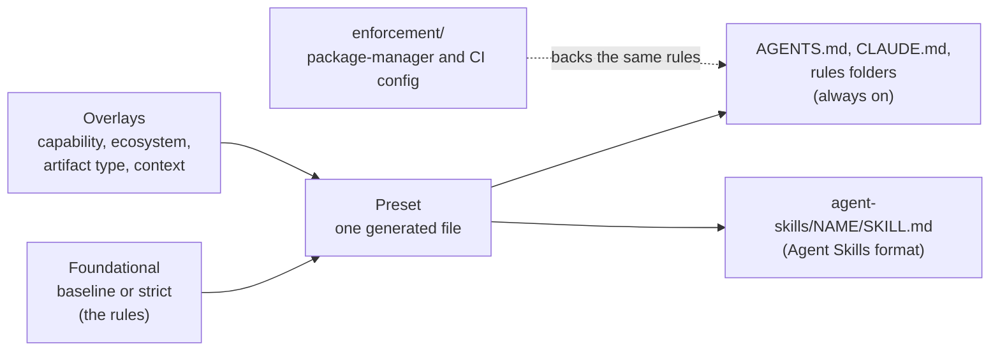

# Agent OSS Dependency Policy

[](LICENSE)

Instruction files that tell AI coding agents how to choose, pin and install open-source dependencies. The aim is to stop agents pulling in unchecked packages without interrupting ordinary work.

**These are instructions, not enforcement.** An agent can ignore them, and they cannot detect a malicious package that looks legitimate. Use them with the tools listed under [What this does not cover](#what-this-does-not-cover).

## The problem

Coding agents now choose and install dependencies with little or no supervision.

- **They install names from memory.** In a study of 16 code-generating models, at least 5.2% of packages suggested by commercial models and 21.7% by open-source models did not exist ([USENIX Security, 2025](https://www.usenix.org/conference/usenixsecurity25/presentation/spracklen)). Attackers register such names ([examples](docs/threat-coverage.md)).
- **They take the newest version.** On 2026-03-31 two malicious `axios` releases were live on npm for about three hours ([Snyk](https://snyk.io/jp/blog/axios-npm-package-compromised-supply-chain-attack-delivers-cross-platform/)). An agent adding axios in that window would have pinned a malicious version.
- **They act on what they read.** In February 2026 a GitHub issue title instructed an AI triage agent to run `npm install` from an attacker's fork, which led to a malicious `cline` release ([Snyk](https://snyk.io/blog/cline-supply-chain-attack-prompt-injection-github-actions)).

## Scope

"OSS" here means anything an agent pulls from a public ecosystem: libraries (npm, PyPI, Maven, Go, Cargo, NuGet, RubyGems), GitHub Actions, container images, MCP servers, editor extensions and third-party agent skills. It covers the agent's own decisions: what to select, install, pin, run, trust and read. It does not cover securing your own release pipeline, your secrets, or code you write.

## Who this is for

| You are | You get |
|---|---|
| A developer | A file to drop into your project so your agent checks before it installs |
| A tech lead or security champion | Rules with IDs, stated rationales and thresholds you can tune and review |
| A platform team | Presets to distribute, config examples that enforce the key rules, and a harness to test agents |

## Quick start

```bash
# 1. Get the files, and read the preset you are about to give your agent
git clone https://github.com/harinee/agent-oss-dependency-policy.git

# 2. From your project root, add a preset to the file your agent reads
cat ../agent-oss-dependency-policy/packaged/baseline-general.skills.md >> AGENTS.md

# 3. Optional: enforce the cooldown and block install scripts in the package manager.
#    Read the comments in the file first; it needs npm 11.10 or later.
cat ../agent-oss-dependency-policy/enforcement/npm/npmrc.example >> .npmrc
```

`AGENTS.md` is read by Cursor, Cline, Roo Code, GitHub Copilot, OpenAI Codex and Devin Desktop. For Claude Code, copy the preset to `.claude/rules/oss-dependency-policy.md` instead (create the folder first). Other locations, presets and the Agent Skills form are in the [quick start guide](docs/QUICK_START.md).

To adjust thresholds, edit the "Tunable thresholds" table in your copy. The defaults are a 7-day version cooldown, 90 days for a new package, and 24 months for a stale one.

| Preset | Use for |
|---|---|
| `baseline-general` | General development. Start here. |
| `prototype-quick` | Prototypes and experiments |
| `npm-high-autonomy` | Node.js with an unattended agent |
| `python-sensitive-repo` | Python in regulated or sensitive settings |
| `strict-agent-high-autonomy` | Production, with an agent that can change CI and containers |
| `java-production`, `go-service`, `rust-project`, `dotnet-project`, `ruby-project` | Those stacks |
| `agent-tooling` | Agents that add MCP servers, extensions or skills |

## Designed to avoid blocking you

A policy that interrupts constantly gets deleted. Every rule here has one response level, and most are the lowest. The list below is what the rules ask an agent to do.

| Level | What the agent does | Used for |
|---|---|---|
| NOTE | Proceeds and reports the check in one line | Most rules |
| ASK | States the finding and waits for approval | Rare, high-risk events: install scripts, sources outside the registry, new MCP servers or CI actions |
| BLOCK | Stops | A package name that does not exist, a version with a malware advisory, instructions found inside content the agent read |

- **Mature dependencies pass.** A stable package at a version older than the cooldown gets a one-line note and no question.
- **The cooldown resolves instead of asking.** If the newest version is too new, the agent installs the newest one that is old enough and says so.
- **Thresholds are yours.** They sit in one table per policy and are labelled as starting hypotheses, not findings.
- **Approved list.** Packages in `.dependency-policy/approved.txt` skip the identity and age-of-package checks.
- **Security-patch fast path.** A version that fixes a published advisory may bypass the cooldown; the agent records the advisory ID.
- **Unattended agents fail closed.** With no human to ask, an ASK becomes: skip the dependency, log why, carry on.

Details: [docs/friction-model.md](docs/friction-model.md).

### Example (illustrative)

This shows the behaviour the policy asks for. It is not a recorded session, and the versions and dates are made up.

> **You:** Add axios and fetch the status endpoint in `health.js`.
>
> **Without the policy:** runs `npm install axios` and gets whatever was published most recently.
>
> **With the policy:** `AGE-1: chose axios 1.13.1 (published 40 days ago); 1.13.2 is 2 days old. SCR-1: installed with scripts off.` Then writes the code.

## How it fits together



Presets are built from their sources by `scripts/build.py`, so they cannot drift. See [docs/packaging.md](docs/packaging.md).

## What the rules address

A rule existing does not mean an agent follows it; see [Limits and status](#limits-and-status).

| Threat | Rules | Example incident |
|---|---|---|
| Invented and lookalike package names | ID-1, ID-2, AGE-3 | Slopsquatting |
| Hijacked new version of an established package | AGE-1, PUB-1, PIN-1, PIN-3 | Axios, March 2026 |
| Install-time code execution | SCR-1 | ChainDrop, August 2026 |
| Trusting provenance, stars or downloads as proof of safety | PRV-1, ADP-1 | Miasma, June 2026 |
| Mutable Action tags and image tags | PIN-4, PIN-5 | TeamPCP, March 2026 |
| Instructions hidden in READMEs, issues, docs and tool output | TRU-1, TRU-2 | ContextCrush, March 2026 |
| Malicious MCP servers, extensions and skills | ART-1 and the artifact overlays | postmark-mcp, September 2025 |

Twelve incidents, with sources, scope and the remaining gap for each: [docs/threat-coverage.md](docs/threat-coverage.md).

## What this does not cover

| Need | Why it is outside this repo | What to use alongside |
|---|---|---|
| Finding known vulnerabilities; automated updates | Needs a vulnerability database and a scanner, not instructions | Software composition analysis (for example OSV-Scanner, `npm audit`, `pip-audit`); Dependabot or Renovate with a cooldown |
| SBOMs and vulnerability management | An inventory and a process, not an agent decision | An SBOM generator (SPDX or CycloneDX) and a tracking process |
| Secret scanning and credential hygiene | The malware in these incidents steals credentials; limiting that is your environment's job | Secret scanning, short-lived and narrowly scoped tokens |
| Hardening your own CI/CD and releases | Only the publisher can fix publisher-side weaknesses | Workflow linting (for example zizmor), trusted publishing, protected branches |
| Private registries, proxies and install-time allowlists | Enforcement at the network or registry | A registry proxy or an install-time firewall (for example Socket Firewall) |
| Verifying signatures and provenance | Cryptographic verification is a tool's job; the policy only says how much weight to give the result | `npm audit signatures`, registry attestations |
| Agent sandboxing and least privilege | Limits what a bad install can reach; instructions cannot | Containers or VMs for agents, permission settings in your agent |
| Human code review | The policy asks the agent to stop; only review makes the stop binding | Required reviews and branch protection |
| Licence review | The policy flags licences; it does not judge them | Your legal process or a licence scanner |
| Incident response | Happens after the fact | A plan for rotating credentials and rebuilding |

## Limits and status

- **Advisory.** Nothing here prevents an agent from doing anything.
- **Not measured.** No agent has been run against these files in this repository. The [eval harness](evals/README.md) is included, with attack and false-positive scenarios; its results directory is empty.
- **A patient attacker wins.** A malicious version that outlives the cooldown passes every rule.
- **Thresholds are judgement calls.** The 7-day cooldown is based on how quickly past malicious releases were removed. The 90-day and 24-month defaults are reasonable guesses with no data behind them.
- **Uneven depth.** npm and Python have the most specific guidance.

The full list is in [docs/limitations.md](docs/limitations.md). Read it before relying on this.

| Part | Status |
|---|---|
| Policy files | Advisory text. Structure checked by `scripts/selfcheck.py` in CI. |
| `enforcement/ci/check_pins.py` | Tested on passing and failing fixtures |
| Other `enforcement/` examples | Settings checked against vendor documentation on 2026-11-24; not run |
| `evals/` | Harness self-test passes with scripted stand-ins; no agent results |

## Documentation

| Document | Contents |
|---|---|
| [Quick start](docs/QUICK_START.md) | Install locations per agent |
| [How to choose](docs/how-to-choose.md) | Presets and building your own |
| [Friction model](docs/friction-model.md) | Levels, thresholds, escape hatches |
| [Threat coverage](docs/threat-coverage.md) | Incidents, rules and gaps |
| [Limitations](docs/limitations.md) | What this cannot do |
| [Packaging](docs/packaging.md) | Sources, presets, Agent Skills |
| [Enforcement](enforcement/README.md) | Config that backs the rules |
| [Evals](evals/README.md) | Testing an agent with and without a policy |
| [Relation to standards](docs/mapping-to-standards.md) | NIST SSDF, OWASP, CIS, SLSA |
| [Why this exists](docs/why-this-exists.md), [Design principles](docs/design-principles.md) | Background |

## Contributing and licence

Contributions are welcome. The most useful are reports of rules that misfired, eval results from real agents, and overlays for ecosystems not yet covered. Start with [CONTRIBUTING.md](CONTRIBUTING.md). Run `make check` before opening a pull request.

MIT. See [LICENSE](LICENSE).
